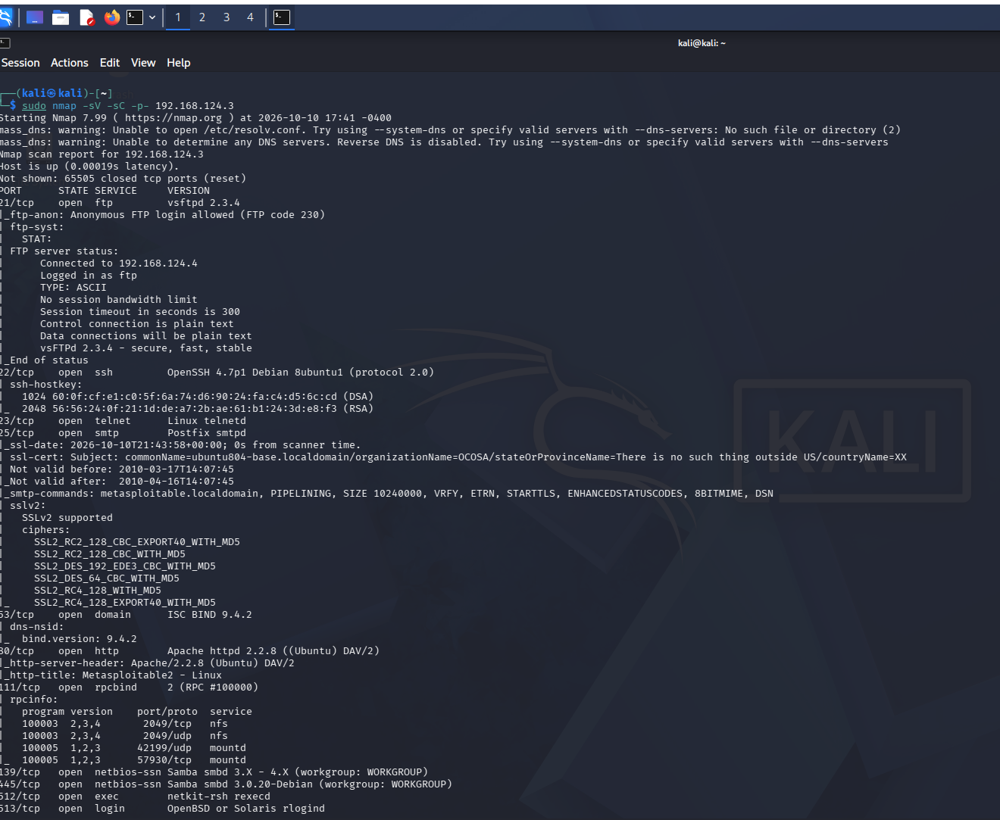
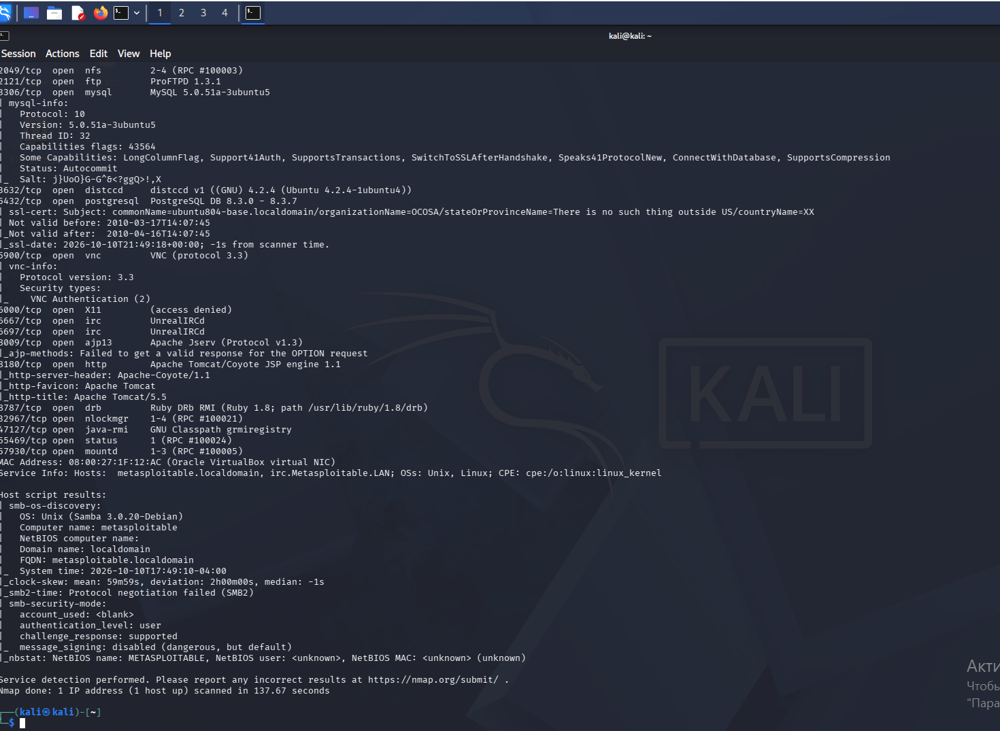

# Домашнее задание к занятию "`Уязвимости и атаки на информационные системы`" Шаблевский О.Н`

### Задание 1

`Скачайте и установите виртуальную машину Metasploitable: https://sourceforge.net/projects/metasploitable/.

Это типовая ОС для экспериментов в области информационной безопасности, с которой следует начать при анализе уязвимостей.

Просканируйте эту виртуальную машину, используя nmap.

Попробуйте найти уязвимости, которым подвержена эта виртуальная машина.

Сами уязвимости можно поискать на сайте https://www.exploit-db.com/.

Для этого нужно в поиске ввести название сетевой службы, обнаруженной на атакуемой машине, и выбрать подходящие по версии уязвимости.

Ответьте на следующие вопросы:

Какие сетевые службы в ней разрешены?
Какие уязвимости были вами обнаружены? (список со ссылками: достаточно трёх уязвимостей)`

### Ответ:

1. [vsftpd 2.3.4](https://www.exploit-db.com/exploits/17491)
2. [Samba 3.0.20](https://www.exploit-db.com/exploits/16320)
3. [UnreallRCd 3.2.8.1](https://www.exploit-db.com/exploits/16922)

---

### Задание 2

`Проведите сканирование Metasploitable в режимах SYN, FIN, Xmas, UDP.

Запишите сеансы сканирования в Wireshark.

Ответьте на следующие вопросы:
- Чем отличаются эти режимы сканирования с точки зрения сетевого трафика?
- Как отвечает сервер?`

### Ответ:
1. SYN → Отправляется пакет с флагом SYN для установки соединения. Ответ SYN/ACK - порт открыт (После происходит сброс соединения RST). Ответ RST/ACK - порт закрыт.
2. FIN → Отправляется пакет с флагом FIN. Ответ RST/ACK - порт закрыт. Если ответа нет - порт открыт|фильтруется.
3. Xmas → Отправляется пакет с флагами FIN/PSH/URG. Ответ RST/ACK - порт закрыт. Если ответа нет - порт открыт.
4. UDP → Отправляет пустой UDP заголовок на каждый порт. Ответ ICMP ошибка о недостижимости порта (тип 3, код 3) - порт закрыт. Другие ICMP ошибки недостижимости - порт фильтруется. После нескольких попыток без ответа - порт открыт|фильтруется. Ответ UDP - порт открыт.
---
